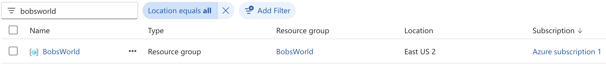

# terraform-jenkins-rg-creation
The objective of this repo is to create a resource group in Azure via Terraform script and Jenkins pipeline. 

Authentication between Jenkins and Azure will be done via service principal and stored in Jenkins credential.

The statefile will initially be stored on the Jenkins server, however in later projects I will be storing it in a storage account to be referenced by other Terraform projects.

## Prerequisites 
-   An azure subscription.
-   A service principal with appropriate RBAC permissions to said above subscription.
-   A credential configured in Jenkins with the above Service Principal.
-   Jenkins pipeline configured to connect to repo for both terraform file and the Jenkinsfile.

## Included Files
The two files included are:
-   main.tf - this is the terraform file used to describe the resources and provider needed.
-   Jenkinsfile - The actual pipeline code to run.

## Procedure
Once the files have been added to the repo, and repo added to the Pipeline configuration in Jenkins. I was able to run the build.

I can see the following has now been created in Azure:

## Conclusion
The design of this project was to keep things simple to just get the pipeline up and running with a basic Terraform resource, with this in mind it was successful.
Some improvements and comments worth mentioning:
-   Remote backend to be added - this will allow the statefile to be used across projects, and maintain consistency across the infrastructure.
-   Additional terraform files - As we add more resources it will be better to add the variables.tf, provider.tf and output.tf files that are standard on most terraform deployments.
-   Resolve some of the security issues - I received the following warning in the Pipeline "Warning: A secret was passed to "withEnv" using Groovy String interpolation, which is insecure." I will research this for later projects.
-   Finally Jenkins itself had some tricky syntax related issues, for later projects I may move to Github actions or even Azure devops.
